<div align="center">

<!-- Header Banner -->


<!-- Animated Typing Text -->
<a href="https://github.com/Bloders-hub">
  
</a>

<p align="center">
  
  
  
</p>

</div>

---

### 🖥️ Live Terminal Inspector

<div align="center">
  
</div>

> **💡 Run the interactive CLI card in your own terminal right now:**
> ```bash
> curl -sSL https://raw.githubusercontent.com/Bloders-hub/Bloders-hub/main/bloders.py | python3
> ```

---

### 🐍 The Bloders Blueprint (`bloders.py`)

```python
from dataclasses import dataclass

@dataclass
class Bloders:
    """Core Developer Profile Specification"""
    role: str = "Systems & Distributed Infrastructure Engineer"
    focus: str = "High-Resilience Backends • POSIX Tooling • Circuit Breakers"
    fuel: tuple[str, ...] = ("Dark Roast Coffee ☕", "Green CI Checkmarks ✅")
    test_armor: str = "100/100 (Pytest / Vitest / Strict TDD)"
    motto: str = "Write code so resilient you can sleep peacefully at night. 🛌💤"

    def on_encounter_bug(self, bug: Exception) -> str:
        # I don't just fix bugs, I teach them to pay rent. 🐛🏠
        return "Bug quarantined, covered with 10 regression tests, eliminated."

if __name__ == "__main__":
    engineer = Bloders()
    print(f"Status: {engineer.role} — Ready to ship bulletproof code.")
```

---

### 🛠️ Tech Stack & Arsenal

<div align="center">

| Domain | Technologies & Tooling |
| :--- | :--- |
| **Languages** |     |
| **Infrastructure & Ops** |    |
| **Databases & Cache** |    |
| **Testing & Armor (100%)** |    |

</div>

---

### 📊 Real-Time GitHub Metrics

<div align="center">
  
  
</div>

<div align="center">
  
</div>

---

### 🏆 Highlighted Open-Source Track Record

* 🚀 **Stellar Creator Portfolio**: Merged infrastructure upgrade adding automated `make dev` local development compose workflows ([PR #1633](https://github.com/yosemite01/stellar-creator-portfolio/pull/1633)).
* 🛡️ **OphirPay**: Engineered zero-lockup 3-state Circuit Breaker with automated Soroban RPC failover & health recovery ([PR #1532](https://github.com/OphirPay/OphirPay/pull/1532)).
* ⚙️ **Protoprimer**: Architected robust POSIX fallback and `ShellDriverSh` runtime isolation ([PR #144](https://github.com/uvsmtid/protoprimer/pull/144)).

---

### ⚡ Quick Facts & Personality

* 🔭 **What I do:** I drop into complex codebases, untangle nasty architectural bottlenecks, and add bulletproof test coverage.
* 🐛 **Bug policy:** Zero tolerance. If a bug manages to spawn, it gets quarantined and covered by 10 regression tests.
* ☕ **Engine fuel:** Freshly ground dark roast coffee + green CI/CD pipelines.
* 🛌 **Life philosophy:** *Code with discipline by day so production sleeps peacefully by night.*

---

<div align="center">


<sub>Crafted with passion, Python &amp; precision by <a href="https://github.com/Bloders-hub">@Bloders-hub</a> 🚀</sub>

</div>
